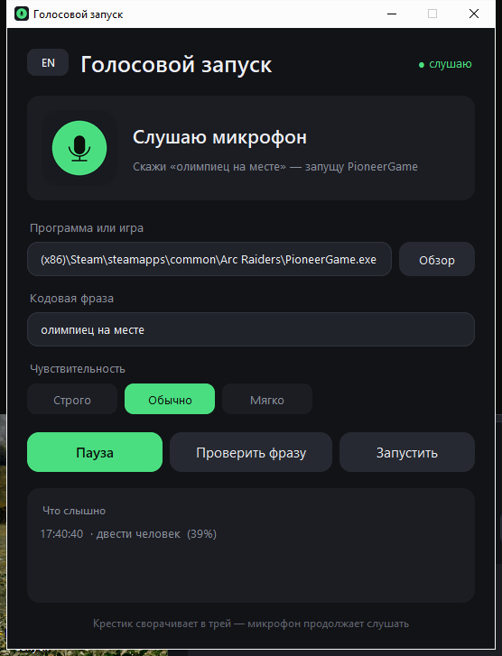
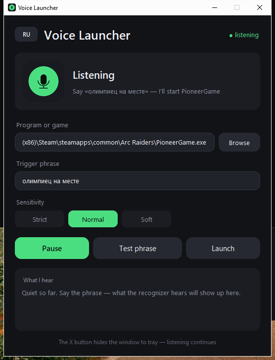

# Запуск игры по кодовой фразе

Маленькое окошко, которое слушает микрофон и запускает игру — или любую
другую программу — когда слышит заданную фразу. Скажи «олимпиец на месте»,
и ARC Raiders стартует сам.



Всё работает **офлайн**: распознавание речи идёт на модели Vosk прямо на
компьютере, звук никуда не отправляется. Ни аккаунтов, ни облака, ни
подписки.

## Что умеет

| Возможность | Как это выглядит |
|---|---|
| **Любая программа** | путь к `.exe` выбирается в окне, по умолчанию — ARC Raiders |
| **Своя фраза** | вписывается в поле, без переобучения и регистрации |
| **Настройка чувствительности** | Строго / Обычно / Мягко — под шумную комнату и тихий микрофон |
| **Проверка фразы** | кнопка слушает 6 секунд и показывает, что именно услышал распознаватель и на сколько процентов совпало |
| **Работа в трее** | крестик прячет окно, микрофон продолжает слушать; вернуться — двойным щелчком по иконке |
| **Ярлык** | создаётся на рабочем столе при первом запуске |
| **Два языка** | кнопка EN/RU в шапке переключает весь интерфейс |
| **Защита от дублей** | если игра уже запущена, второй клиент не откроется |

<p align="center">
  
  
</p>

## Быстрый старт

1. Скачай папку (или `git clone`) и запусти **`start.cmd`** двойным щелчком.
2. При первом запуске приложение предложит скачать модель распознавания
   (~45 МБ) — это один раз и только с официального зеркала Vosk.
3. Выбери `exe` игры, впиши фразу — и говори.

`start.cmd` сам поставит зависимости, если их нет, и запустит приложение без
чёрного окна консоли. Нужен установленный Python 3.10+.

## Как это работает

1. Микрофон непрерывно пишется кусками по 0,25 с — без записи на диск.
2. Vosk распознаёт речь локально и отдаёт текст: «олимпиец на месте».
3. Текст сравнивается с заданной фразой двумя способами: посимвольно и с
   сортировкой слов (чтобы прощался порядок слов). Берётся лучший результат.
4. Если он выше порога — приложение запускает `exe` и пищит.

Сравнение нестрогое специально: «олимпийцы на месте» (91 %) и «олимпиец на
мсте» (97 %) тоже сработают, а «олимпиада на месте» (86 %) — уже нет.

## Почему оно не запускается от каждой фразы в комнате

Порог по умолчанию — 88 из 100. Он подобран так, чтобы прощать огрехи
распознавания, но отсекать похожие по звучанию фразы. Если ловит лишнее —
переключи чувствительность на «Строго» (92), если наоборот не ловит —
на «Мягко» (82).

Плюс есть кулдаун: одна и та же фраза не запускает игру дважды подряд.

## Если не срабатывает

1. Нажми **«Проверить фразу»** и посмотри журнал «Что слышно». Если там мусор —
   дело в микрофоне, а не в пороге.
2. Микрофон меняется в `config.json` полем `device` (индекс покажет
   `python -c "import sounddevice; print(sounddevice.query_devices())"`).
3. Фразу лучше брать из 2–3 редких слов: одно короткое слово распознаётся хуже.

## Требования

* Windows 10/11, Python 3.10+
* Микрофон
* ~50 МБ на модель распознавания (скачивается автоматически)

Зависимости: `vosk` (офлайн-распознавание), `sounddevice` (микрофон),
`rapidfuzz` (сравнение строк), `pystray` + `Pillow` (иконка в трее).
Интерфейс — на стандартном `tkinter`.

## Оформление

* Один шрифт на всё — **Segoe UI** (Light / обычный / Semibold): полноценная
  кириллица и латиница, хорошо хинтован под GDI, которым рисует Tk.
* Скруглённые панели и поля отрисованы в 4× разрешении и уменьшены
  с Lanczos-сглаживанием — без «лесенки» на углах.
* HiDPI: приложение объявляет себя per-monitor DPI-aware и масштабируется
  под 125 %/150 %.
* Две статичные картинки состояния — «слушаю» и «пауза» — без анимации.

## Файлы

```
app.py             — всё приложение: движок, окно, трей
config.json        — настройки (путь, фраза, порог, микрофон)
start.cmd          — установка зависимостей и запуск
requirements.txt   — зависимости Python
icon.ico           — иконка (создаётся автоматически)
model\             — модель Vosk (скачивается автоматически)
app.log            — журнал
tests\audio\       — записи для проверки распознавания
tools\             — утилиты: тесты, снимок окна, сравнение шрифтов
```

## Тесты

```powershell
python tools\test_engine.py                      # логика срабатывания
python tools\test_recognition.py tests\audio     # распознавание записей
```

`test_engine.py` проверяет, что фраза ловится в разных вариантах, а похожие
фразы и посторонняя речь — нет. Сейчас 10 из 10.

## Лицензия

MIT — делай что хочешь, только сохрани упоминание авторства.
